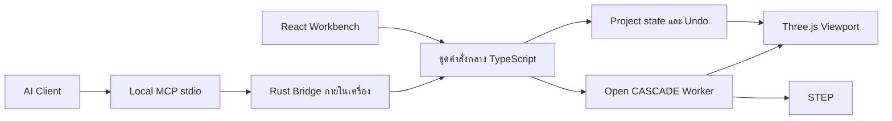

# แผนพัฒนา Assembly Lab ให้ AI เรียกใช้งานได้

Assembly Lab จะเป็น Workbench สำหรับออกแบบชิ้นส่วนและจำลองการเคลื่อนไหวของแขนกล โดยผู้ใช้แก้โปรเจกต์จากหน้าจอได้ตามปกติ และ AI เรียกชุดคำสั่งเดียวกันผ่าน MCP ได้ เป้าหมายรุ่นแรกคือให้ AI อ่านฉาก แก้มิติอะแดปเตอร์ บันทึกท่า UR10e และส่งออก STEP จากโปรเจกต์ที่กำลังเปิดอยู่ โดยผู้ใช้เห็นผลใน Viewport และย้อนการแก้ไขได้จาก Undo เดิม

ประมาณการสำหรับนักพัฒนา 1 คนเต็มเวลาและใช้โค้ดเดิมต่อ **4–6 สัปดาห์สำหรับ MVP ที่ AI เรียกได้บน macOS** และ **10–16 สัปดาห์สำหรับ MVP ที่รวม IK การตรวจการชน และเครื่องมือสร้าง Solid พื้นฐาน** ตัวเลขเป็นเวลาสะสมจากวันเริ่มงานและรวมเวลาทดสอบในแต่ละช่วง ขอบเขตนี้เน้น Workbench แขนกลและ CAD โดยใช้ความสามารถของ Blender เป็นแบบอ้างอิงด้านการจัดฉากและแอนิเมชัน

## ฐานที่ใช้ต่อได้

- **Viewport และการตรวจชิ้นส่วน** มี Three.js, Scene Hierarchy, Gizmo, Snap, ระนาบตัด, วัดระยะ, Exploded View และ Service Mode [โค้ด Viewport](../src/viewport.js)
- **แขนกลและ Timeline** มี UR10e, การปรับ J1–J6, การอ่านตำแหน่งปลายแขน, Teach Pose และเดโม Pick & Place [โมเดลแขนกล](../src/robot.js) · [Timeline และเดโม](../src/program.js)
- **CAD** มีแผ่นอะแดปเตอร์พาราเมตริก การ Trace จากภาพหรือโมเดลอ้างอิง และการสร้าง Solid/STEP ด้วย Open CASCADE [ชุดคำสั่ง CAD](../src/adapter-kernel.js) · [แผง Trace](../src/TracePanel.jsx)
- **ไฟล์โปรเจกต์** มีการเปิด–บันทึก `.assemblylab` และหน้าต่างเลือกไฟล์ของ macOS ผ่าน Tauri [รูปแบบไฟล์ปัจจุบัน](../src/project-file.js) · [คำสั่ง Rust](../src-tauri/src/main.rs)

ประวัติ Undo และการประกอบข้อมูลโปรเจกต์บางส่วนอยู่ใน React ส่วน transform ของวัตถุอ่านจาก Viewport ขั้นแรกจึงย้ายการเปลี่ยนข้อมูลที่ต้องบันทึกกลับมาไว้ในชุดคำสั่งที่เรียกได้โดยไม่ต้องจำลองการคลิก UI [การจัดการสถานะปัจจุบัน](../src/App.jsx)

## สถาปัตยกรรม

1. **Project state** เก็บ ID คงที่ของวัตถุและชิ้นงาน, มิติ CAD, ท่าแขนกล, keyframe และ revision ปัจจุบัน ส่วนกล้อง การเลือกวัตถุ และตำแหน่ง playhead เป็นสถานะการดูหรือแก้ไขที่บันทึกได้ตามรูปแบบโปรเจกต์เดิม การหมุนกล้องไม่เพิ่ม revision ของแบบชิ้นงาน
2. **ชุดคำสั่งกลาง** รับชื่อคำสั่งและ arguments แบบมี schema ตรวจช่วงค่า หน่วย และ ID ก่อนแก้ข้อมูล ทั้ง UI และ MCP ส่งคำสั่งเข้าเส้นทางเดียวกัน กระบวนการหนึ่งชุดบันทึกเป็น Undo หนึ่งรายการ โดยการกด Undo หรือ Redo ออก revision ใหม่
3. **CAD Worker** สร้าง Solid และ mesh จากพารามิเตอร์ชุดเดียวกัน Viewport แสดง mesh ส่วน STEP ส่งออกจาก Solid ของ revision ที่ถูกเลือก งานสร้างรูปทรงที่ใช้เวลานานคืน job ID และผูกผลกับ revision ต้นทาง
4. **MCP บนเดสก์ท็อป** ให้ AI client ที่รองรับ `stdio` เรียกโปรเซส MCP ภายในเครื่อง ตัว bridge ส่งคำสั่งผ่าน IPC ไปยังหน้าต่าง Tauri ที่ผูกกับโปรเจกต์นั้น หากโปรเจกต์เปลี่ยนระหว่างคำนวณ ให้คืนสถานะ conflict พร้อม revision ล่าสุด เว็บใช้ชุดคำสั่งกลางผ่าน UI เช่นกัน การเปิดให้ AI ภายนอกเรียกเว็บเป็นช่วงถัดไปผ่าน endpoint ที่ระบุบัญชีและโปรเจกต์ได้ [MCP SDK](https://ts.sdk.modelcontextprotocol.io/server) · [Tauri IPC](https://v2.tauri.app/concept/inter-process-communication/)

[วิธีเชื่อม Assembly Lab Desktop กับ MCP client](desktop-mcp.md)

## คำสั่ง MCP รุ่นแรก

| กลุ่ม | คำสั่ง | สัญญาที่ต้องทดสอบ |
|---|---|---|
| อ่านฉาก | `get_scene`, `get_body`, `get_robot_pose` | คืน `project_id`, revision, ID ของวัตถุ, มิติเป็นมิลลิเมตร, มุมเป็นองศา และกรอบอ้างอิงของ TCP |
| สร้างและตรวจตัวอย่าง | `preview_changes`, `get_job` | รับรายการแก้ไขและ revision ต้นทาง คืน preview ID หรือ job ID พร้อมผลตรวจมิติ และแสดงรูปทรงตัวอย่างโดยยังไม่เปลี่ยนโปรเจกต์ |
| แก้ชิ้นงาน | `set_adapter_dimensions`, `build_trace_solid` | ใช้พารามิเตอร์และ Trace ในโปรเจกต์ที่เปิดอยู่ ตรวจความถูกต้องก่อนสร้าง Solid และคืนมิติที่สร้างได้จริง |
| สอนท่าแขนกล | `set_joint_angles`, `save_pose`, `preview_motion` | ตรวจช่วง J1–J6 คืนท่าที่ใช้จริงและหมายเลขเฟรม ให้ผู้ใช้เล่นตัวอย่างใน Timeline ได้ |
| ยืนยันการแก้หลายคำสั่ง | `apply_changes`, `undo`, `redo` | ตรวจ `expected_revision` ก่อนเขียน ใช้ preview ID เพื่ออ้างอิงผลที่ผู้ใช้เห็น และย้อนการแก้แบบทั้งชุดได้ |
| ส่งออก | `export_step`, `export_glb` | ระบุ ID ของชิ้นงานหรือฉากและ revision ที่ส่งออก คืนผลลัพธ์ที่เปิดหรือบันทึกจาก Workbench ได้ |

ผลตอบกลับใช้รหัสที่แยกกรณีได้ เช่น `INVALID_DIMENSIONS`, `REVISION_CONFLICT` และ `PROJECT_NOT_OPEN` พร้อมข้อความและข้อมูลที่ AI ใช้แก้คำสั่งได้ คำสั่งที่เปลี่ยนข้อมูลรับ request ID เพื่อให้การส่งซ้ำจาก timeout ไม่สร้าง keyframe หรือรายการ Undo เพิ่ม

## ลำดับส่งมอบ

| เวลาสะสม | งานที่ทำ | เกณฑ์ผ่าน |
|---|---|---|
| **สัปดาห์ 2–3** | นิยาม Project state, ID และ schema ของคำสั่ง ย้าย transform, มิติอะแดปเตอร์ และ Teach Pose เข้า Undo/Redo กลาง เตรียมตัวอ่านไฟล์รุ่นเดิม | เปิดไฟล์ `.assemblylab` รุ่นปัจจุบันได้ UI และการเรียกคำสั่งตรงให้ผลเดียวกัน การแก้แบบชุดย้อนกลับได้ในครั้งเดียว |
| **สัปดาห์ 4–6** | ต่อ MCP local กับหน้าต่าง macOS เพิ่มเครื่องมืออ่านฉาก แก้มิติ สอนท่า ตัวอย่างก่อนใช้จริง และส่งออก STEP/GLB | AI client อ่านและแก้โปรเจกต์ที่เปิดอยู่ได้ เห็นผลใน Viewport ส่งออกและ Undo ได้ และจัดการคำขอที่ revision ล้าสมัยได้ |
| **สัปดาห์ 7–11** | เพิ่มการลากเป้าหมาย TCP, IK สำหรับ UR10e และการตรวจการชนในฉาก Pick & Place | เป้าหมายที่เอื้อมถึงขยับแขนได้ตามค่าคลาดที่กำหนด เป้าหมายที่เอื้อมไม่ถึงและการชนถูกแสดงพร้อมจุดหรือชิ้นส่วนที่เกี่ยวข้อง |
| **สัปดาห์ 10–16** | เพิ่ม Primitive, Extrude, Hole และ Boolean พร้อมรายการขั้นตอนสร้างชิ้นงานที่กลับมาแก้ขนาดได้ | สร้างชิ้นงานจากหลายขั้นตอน แก้ขนาดของขั้นตอนต้นแล้วคำนวณใหม่ได้ เปิดโปรเจกต์กลับมายังแก้ต่อได้ และ STEP เปิดเป็น Solid ใน FreeCAD |

ช่วง IK ใช้โมเดลการชนแบบง่ายสำหรับการตรวจในฉากจำลอง ความแม่นยำของ IK และผลตรวจการชนต้องกำหนดจากฉากทดสอบก่อนใช้เป็นเกณฑ์ผ่าน

## ชุดทดสอบรับงานรุ่นแรก

- **CAD จากคำสั่งภาษาไทย** — ให้ AI เปลี่ยนอะแดปเตอร์เป็นหนา 18 มม. และมีรูน็อต 6 รูด้วยมิติอ้างอิงที่ผ่านการตรวจระยะรอบรู ดูตัวอย่างใน Viewport แล้วใช้การแก้เป็นชุดเดียว ส่งออก STEP และเปิดใน FreeCAD เพื่อตรวจ Solid ความหนา และจำนวนรู
- **แก้ท่าจาก AI และ UI** — บันทึกท่าสองเฟรมผ่าน MCP เล่นและเลื่อน Timeline จาก UI แล้ว Undo การบันทึกหนึ่งครั้ง เปิดไฟล์โปรเจกต์ที่บันทึกไว้เพื่อยืนยันว่าท่าที่เหลือตรงกับในฉาก
- **แก้พร้อมกันและส่งคำสั่งซ้ำ** — ให้ AI สร้างตัวอย่าง จากนั้นเปลี่ยนขนาดด้วย UI ก่อนกดใช้ตัวอย่าง ผลเก่าต้องคืน conflict และไม่ทับค่าปัจจุบัน ส่ง request ID เดิมซ้ำแล้วประวัติ Undo ต้องไม่เพิ่ม
- **ความเข้ากันได้ของไฟล์** — เปิด–บันทึกไฟล์เดิมที่มี Teach Pose, Trace และค่ามุมมอง ตรวจว่าโปรเจกต์ที่บันทึกใหม่ยังเปิดได้ และผล STEP/GLB สอดคล้องกับ revision ที่ส่งออก
